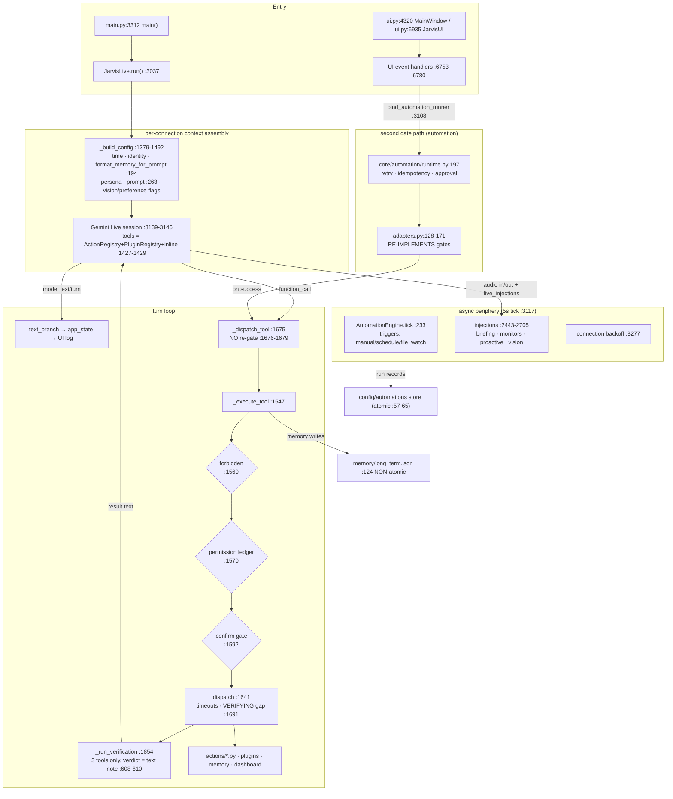

# BRAIN V0.1 — Current Architecture (spec §2, traced)

All claims VERIFIED at `db7689c` unless tagged otherwise. Companion: `BRAIN_AUDIT.md`.

## 1. Actual runtime pipeline (traced, not as-designed)

### Differences from the documented "AI Core pipeline"

| Designed stage | Actual (VERIFIED) |
|---|---|
| Intent Engine | **No module.** The model chooses tools via prompt + schemas (`core/prompt.txt:28-32`); keyword persona switch (`main.py:1143-1176`) is the only non-model intent code |
| Context Engine | `_build_config` runs **once per connection**, not per turn. Mid-session memory writes don't re-enter context (`main.py:468-476` acknowledges this) |
| Reasoning/Planning | **Prompt-text instructions only.** The planner/reasoning/replanner/self-checker modules are tests-only (see AUDIT §5) |
| Task Graph | Two graphs: dormant `core/task_graph.py` (no executor) and live `core/automation/schema.py` |
| Verification | Runs post-hoc as a **text note appended to the result** (`main.py:597-613`); model reads it, nothing enforces it. Automation's own `looks_like_failure` sniffer ignores it (`adapters.py:26-33`) |
| Execution | Single spine — but gates exist **twice**: `_execute_tool` and the automation adapter mirror |
| Recovery | Model decides from failure strings; structured retries only inside automation + connection/model ladders |

## 2. Missing stages

- **Intent classification** — absent as a stage; model-prompt does routing (gap A).
- **Per-turn context selection** — context is assembled once per connection; no retrieval-augmented re-injection.
- **Structured verification verdict** — verdicts are prose; no pass/fail field flows into dispatch, automation, or UI state (`VERIFYING` state has no emitter, `app_state.py:12-14`).
- **Logging/observability layer** — no `logging` config anywhere; UI ring + event bus only (AUDIT §1#23).
- **Learning loop** — `RungStats` (`core/model_manager.py:67`) collected but never consumed; no eval harness.

## 3. Duplicated logic (each is a drift hazard)

| Duplication | Sites (VERIFIED) | Drift status |
|---|---|---|
| Gate order (forbidden→permission→confirm) | `main.py:1547` vs `adapters.py:128-171` | **Already drifted**: automation path misses `shutdown_jarvis` fail-closed rule (`main.py:1593-1612`) |
| Failure-string sniffing | `_run_verification` markers (`main.py:599-603`) vs `adapters.py:26-33` vs dead `schema.py:189-206` | Three sniffer implementations; markers don't include `[VERIFICATION FAILED]` |
| API-key reading | 6 sites (AUDIT §1#3) | `ui.py:6911-6916` rewrites whole file; others read-only |
| Tool metadata (availability/risk) | inline `TOOL_DECLARATIONS` `main.py:345` + `actions/*.py TOOL` + `plugins/*.py PLUGIN` | Merged once at boot (`main.py:1427-1429`) — OK; but `capability.py:84-88` can't read records (list-vs-dict bug) |
| Risk vocabularies | `permissions.py` 8-word · `automation risk.py` safe/caution/dangerous · `plugin risk` safe/caution/dangerous · `verifier confidence` high/medium/low | Four closed vocabularies, no translation table |
| Atomic vs plain writes | `store.py:57-65` atomic; ~10 other writers plain | Memory/config can corrupt on crash |

## 4. Disconnected modules (implemented, never reachable from the running app)

Dormant cluster: `planner.py`, `task_graph.py`, `reasoning.py`, `replanner.py`, `self_checker.py`, `tool_registry.py`, `memory_v2.py`, `llm_client.py`, `installer.py`. Plus dead states `PLANNING`/`OBSERVING`, `session_memory` (always `None`, `main.py:1812`), `add_short_term_turn` buffers, most `EventType`s, `safety_manager` rate-limit/audit (`safety_manager.py:15-16` promises unimplemented behavior). Full register: `BRAIN_AUDIT.md` dormant-code list.

## 5. Unnecessary model calls (INFERRED, low priority)

- Vision re-sends accumulated image history each polling turn (`main.py:2108-2149` round-robin) — budget-capped (`VISION_MAX_CHARS=2400` `:2119`), acceptable.
- Proactive `chat_once` runs on the background one-shot funnel every 30–60 s when conditions match (`main.py:2668-2705`) — cheap model used for a keyword-scored trigger; a local check already gates it. **No egregious redundancy found**: the design already funnels all one-shots through `core/gemini.py:319` (single call site).

## 6. Unverified paths (code exists, no test proves it runs)

| Path | Evidence |
|---|---|
| DOM_CHECK / SCREENSHOT verifier strategies | Explicit stubs raising `NotImplementedError`-style responses (`verifier.py:350,:359`); `browser_control.py:1091` "DOM checks are not implemented" |
| `PROVIDER_UNSUPPORTED` visual path | `provider.py:143` deliberately raises — capability contract, but untested consumers? |
| Dashboard toasts / emergency-stop UI | Server endpoints exist (`server.py:870`); no test drives browser→backend |
| Briefing text injection into Live session | `main.py:2443-2517` builds `live_injections`; wire-verified only |
| Double-tap overlay start | Tests cover model run verb + gate messages (`tests/` Phase 13 additions); full UI gesture untestable headless |

## 7. Wrong assumptions baked into current design (each contradicts code)

1. "Verification gates execution" — it never does; automation docstring promises it does (`runtime.py:8-9`).
2. "A planning agent handles multi-step work" (`core/prompt.txt:136`) — no such tool.
3. "Rate limit + audit trail" (`safety_manager.py:15-16`) — zero callers.
4. "Dangerous workflows pause for approval" (`risk.py:10-11`) — only idempotency + no-retry exist; approval is a *node type* the model must emit.
5. "Memory is part of every turn" — it's per-connection; writes land after assembly.

## 8. Bottlenecks (VERIFIED code-path characteristics)

- **`main.py` monolith**: 3,338 lines; `JarvisLive` holds AI, tools, injections, connection, briefing. Change-fragility risk (INFERRED from size + module list).
- **Cold-boot import cost**: `sounddevice`, `numpy`, `google.genai`, `JarvisUI` imported before connect (`main.py:52-103`) — startup latency (UNQUANTIFIED — measurable via `core/perf.py` marks already present).
- **JSON file I/O on hot paths**: every `remember` rewrites `long_term.json`; store uses atomic replace but holds no lock (concurrent writer → last-write-wins, INFERRED).
- **5 s trigger polling** (`engine.py:233`): schedule/file-watch granularity ≤5 s by design; fine for V0.1, noted for V0.2+.
- **Single confirm slot** (`confirm.py:46`): concurrent confirmable tool calls queue/coalesce — a deliberate serialization point (INFERRED).

## 9. What is genuinely strong (preserve in any refactor)

1. **Gate triangle**: availability→consent ordering, fail-closed metadata, non-forgeable confirmation (UI-only resolve, 90 s expiry, test-enforced) — `main.py:1573-1612`, `test_tool_metadata.py:263-279`.
2. **One dispatch spine**: `_dispatch_tool` shared by chat and automation with deliberate no-re-gate contract (`main.py:1676-1679`).
3. **Automation store**: atomic writes, caps, idempotency keys (`store.py:57-65,23`).
4. **Model ladder + timeouts**: every one-shot funnels through `core/gemini.py:319` with tier demotion on quota (`model_manager.py:117-138,169-201`).
5. **Event bus with single bridge** into UI (`main.py:2830`) — one integration point for observability work.
