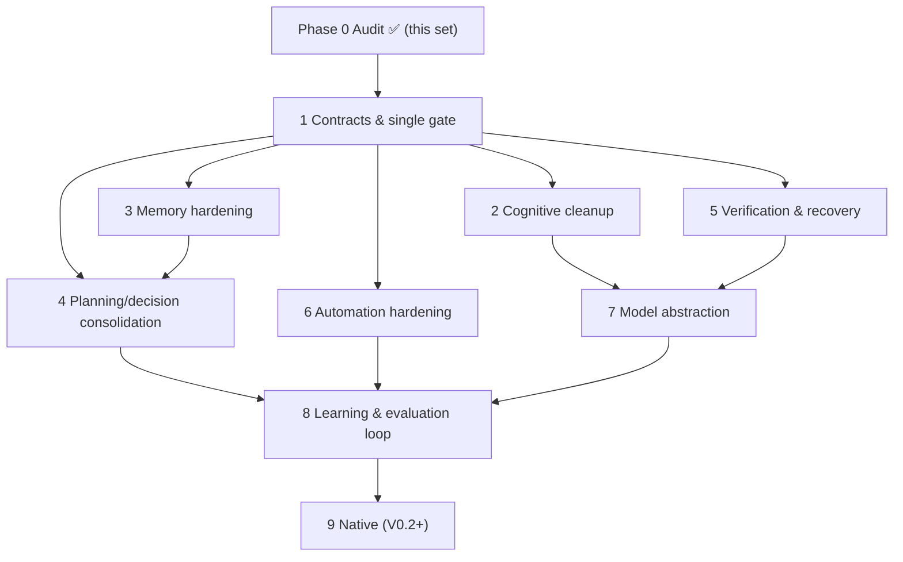

# BRAIN V0.1 — Implementation Roadmap (spec §11)

**Phase 0 (this document set) is complete — audit and design only; no source was modified.**
Order below is **re-justified** against the spec's original sequence (justification in §0). Every phase keeps the suite green (baseline **1,454 tests**) and remains reversible: one phase = one PR-sized change.

## 0. Reorder justification (evidence-based)

The spec proposed Contracts → Integration → Memory → Planning → Verification → Automation → Model → Learning → Native. Audit found **three live honesty/correctness defects** (gate drift, verifier-not-propagated, capability list-vs-dict) that make *current* behavior untruthful — those are Phase 1, before any new wiring. Evaluation scaffolding moves **early** (Phase 1) because every later phase's acceptance criteria must be measurable. Planning/decision consolidation moves **after** verification because a planner built on an unverifiable gate chain would be unauditable.

## Phase 1 — Contracts & single gate (correctness first)
- **Objective:** one gate implementation; structured verdicts; capability catalog fixed.
- **Reuse:** `_execute_tool` gate block (`main.py:1560-1612`), `verifier.py` strategies, `ActionRegistry` records (`action_loader.py:180`).
- **Changes:** extract `core/gates.py::evaluate_gates()`; call it from `_execute_tool` **and** `adapters.py:128-171` (delete mirror); `_run_verification` returns `Verdict`; `looks_like_failure` consumes it; `capability.py:84-88` reads list; risk-vocabulary translation table; delete dead `schema.py:189-206`; add `logging` config (stdlib, no deps).
- **Depends on:** nothing. **Risks:** behavior parity at every gate — mitigate with existing `test_tool_metadata.py` + new parity tests.
- **Tests:** gate-parity tests (both paths, all 4 denial rules incl. `shutdown_jarvis` fail-closed); verdict-structure tests; capability negative test (missing required param rejected, param named); log-config smoke.
- **Acceptance:** grep = one gate fn, one failure matcher, one catalog reader; automation docstring `runtime.py:8-9` becomes true; suite ≥1,454 green.

## Phase 2 — Cognitive cleanup (retire the fakes)
- **Objective:** remove/finalize dormant code that misrepresents the system.
- **Reuse:** model chaining (`main.py:2291-2300`) stays the reasoning engine; `automation/schema.py` stays the only graph.
- **Changes:** delete or quarantine `core/reasoning.py`, `core/self_checker.py` placeholders (their `self_check` can never pass — `reasoning.py:179-180`); fix prompt-vs-code lies (`core/prompt.txt:136` "planning agent", `safety_manager.py:15-16` promises) or implement the promised behavior if tests exist; `PLANNING`/`OBSERVING` states get emitters **or** the states are removed; `session_memory` slot wired or removed (`main.py:1812`).
- **Depends on:** Phase 1 (verdicts give `VERIFYING`/`OBSERVING` something real to report).
- **Risks:** deleting code some test imports — move tests with it.
- **Tests:** no test references deleted modules (import audit); state-emitter tests.
- **Acceptance:** every docstring/prompt claim has a matching code path (re-run the discrepancy checklist from `BRAIN_AUDIT.md`).

## Phase 3 — Memory hardening
- **Objective:** durability + measurable recall; live memory updates reach context.
- **Reuse:** `memory_manager.py`, atomic pattern from `store.py:57-65`, `live_injections` channel (`main.py:2108-2149` pattern).
- **Changes:** atomic writes for `long_term.json` + sessions; dedupe on `remember`; `_SESSION_MAX` configurable; on memory write, append bounded injection so mid-session recall works (`main.py:468-476` gap).
- **Depends on:** Phase 1 (logging) for trim/write observability.
- **Risks:** injection token budget — respect `VISION_MAX_CHARS`-style caps.
- **Tests:** crash-safety (simulated partial write → loads); dedupe; injection appears in `_build_config` output; trim notifier still fires.
- **Acceptance:** EVAL M1 baseline captured (before/after relevance scores).

## Phase 4 — Planning & decision consolidation
- **Objective:** exactly two plan producers (model chain + automation generator); gate consolidation from Phase 1 proven under planning load.
- **Reuse:** generator `generate()` (`generator.py:355`), `validate.py`.
- **Changes:** decide `core/planner.py` fate via EVAL M3 — **fix-then-wire** (duplicate ids `:197-228`, string risk `:373`, logged-only validate `:131-132`) *only if* M3 shows model chaining failing multi-step tasks; otherwise delete; same fate for `task_graph.py`/`replanner.py`. Manual-run concurrency guard (`engine.py:164` RUNNING status).
- **Depends on:** Phase 1 (planner needs a trustworthy gate), Phase 2 (no competing fakes).
- **Risks:** temptation to build a second general planner — explicitly rejected by gap-D.
- **Tests:** if wired: 10 planner unit fixes (unique ids, risk enum) + integration through gates; if deleted: import audit. Concurrency test for manual runs.
- **Acceptance:** one documented planning interface; M3 result recorded in this doc's errata section.

## Phase 5 — Verification & recovery coverage
- **Objective:** verification spans more tools with structured verdicts; recovery ladders validated.
- **Reuse:** strategy framework, automation retry/idempotency, connection/model ladders.
- **Changes:** add CUSTOM strategies where cheap assertions exist (screen visible → element/text check via existing screenshot OCR? only if already available — **no new deps**); emit `VERIFYING` from `_run_verification`; label failure logs for replanner's classifier.
- **Depends on:** Phase 1 (verdict envelope).
- **Risks:** flaky visual assertions — gate behind stability tests.
- **Tests:** per-strategy unit tests incl. honest "cannot verify" outcome.
- **Acceptance:** ≥N tools verified with measured false-fail rate (EVAL M5); `[VERIFICATION FAILED]` never reaches automation as success.

## Phase 6 — Automation integration hardening
- **Objective:** finish boundary fixes not covered by Phase 1.
- **Changes (residual):** idempotency at store level for concurrent writes; file-watch trigger docs say "polling" honestly; dashboard key-merge write (`ui.py:6911-6916` → use `config_manager.py:20-34` merge); egress/firewall `shell=True` review (`server.py:187`); `desktop.py` exec confirmation default → caution (or explicit sandbox test proving constraint set).
- **Depends on:** Phase 1.
- **Risks:** desktop exec change could break non-interactive flows — require-confirm only for new interactive sessions, tested.
- **Tests:** existing 100-test automation suite stays green; new tests for merge-write + exec policy.
- **Acceptance:** security risk #1 and #4 from `BRAIN_AUDIT.md` §8 closed or explicitly accepted with rationale.

## Phase 7 — Model abstraction
- **Objective:** provider-agnostic call interface; local-model opt-in; ladder learns "provider down".
- **Reuse:** `gemini.py:319`, `llm_client.py` (adopt after health/timeout review), `ModelManager` tiers/ladder, `LIVE_SLOTS`.
- **Changes:** formalize `ModelCall`/`ModelResult`; adapter for Ollama/OpenAI behind ladder; provider metadata fields; config keys; cancellation token honored by adapters.
- **Depends on:** Phase 1 (logging shows provider swaps), Phase 2.
- **Risks:** unmeasured local-model latency — measure (EVAL M7) before recommending; never silent execution on provider failure.
- **Tests:** adapter contract tests (same prompt → same shape across mocked providers); ladder steps down on provider error not just quota; no key ever logged.
- **Acceptance:** config-switch demo (Ollama echo test) documented with measured latency.

## Phase 8 — Learning & evaluation loop
- **Objective:** harness from `EVALUATION_PLAN.md` runs in CI-lite; `RungStats` consumed.
- **Changes:** dataset builders from session logs (anonymized); scorer scripts; dashboards for automation statistics already collected; tier feedback from stats (bounded: ladder preference only).
- **Depends on:** all prior phases (they supply the metrics they promised).
- **Risks:** self-referential metrics — keep labeled human/ground-truth sets for M2/M3/M4.
- **Acceptance:** one command produces the M1–M7 scorecard; results pasted into this roadmap's errata.

## Phase 9 — Native intelligence (V0.2+, PROPOSED)
- **Objective:** performance-critical hot paths only, after measurements justify.
- **Inputs:** Phase 8 data (e.g., OCR, audio DSP, graph validation timing).
- **Constraints:** Python stays source of truth; native = drop-in accelerators with identical tests; no new deps without an evaluated spike.
- **Acceptance:** measured speedup ≥2× on the targeted path with suite green.

## Dependency graph

## Errata / progress log

- **Phase 1 — COMPLETED** (this repo state): `core/gates.py::evaluate_gates` + `message_for` are the single rule/wording source, called by `_execute_tool` (`main.py:1564`) and `build_tool_call` (`adapters.py:146`); automation now enforces the `shutdown_jarvis` user-turn fail-closed rule; `_run_verification` returns `(text, verdict)` with `response["verification"]` consumed by the adapter (a passed=False verdict → node error, `runtime.py:8-9` docstring now true); `ActionRegistry.record()` + `CapabilityCatalog._record_for` handle the real list-shaped registry so `validate.py:166` required-param checks work; dead `NodeResult.from_tool_output` deleted (single failure matcher = `adapters.FAILURE_MARKERS`); `_configure_logging()` wired in `main()`; risk vocabularies verified identical (`RISK_LEVELS == RISK_ORDER`) with a drift test instead of a translation table. Source guards in `test_permission_enforcement.py`/`test_tool_metadata.py` updated to guard the seam at its new home (both paths). Tests: **1487 passed, 51 warnings** (baseline was 1454/51; +36 new, −3 dead-code tests). Boot verified (PID 12468, engine ready/scheduler started/3 verify rules).
- **Found during Phase 1 boot (pre-existing, NOT this phase):** `core/spatial/gesture_recognizer.py:116,223` pass `intent` as raw strings (`"drag_move"`, `"rotate_cw"/"rotate_ccw"`) while `safety_controller.py:82` calls `event.intent.value` → recurring `Processing loop error` whenever pinch-drag/rotate fires (caught by the loop, app stays up, gestures degraded). Fix = use `GestureIntent.DRAG_MOVE/ROTATE_CW/ROTATE_CCW` members; scheduled as a separate follow-up, not folded into Phase 1.

## Global risks & mitigations
1. **Scope creep into "build a second brain"** — mitigation: every phase starts from reuse columns; non-goals list in gap analysis is binding.
2. **Security regression while refactoring gates** — mitigation: `test_tool_metadata.py` confirm-invariants run in Phase 1 first, parity tests added before deleting the mirror.
3. **Test-count pressure** — baseline 1,454; phases add tests, never delete coverage silently; deletions only with import audits.
4. **Doc drift** — each phase updates `docs/brain/*` errata; disallowed claims re-checked (Phase 2 checklist).
