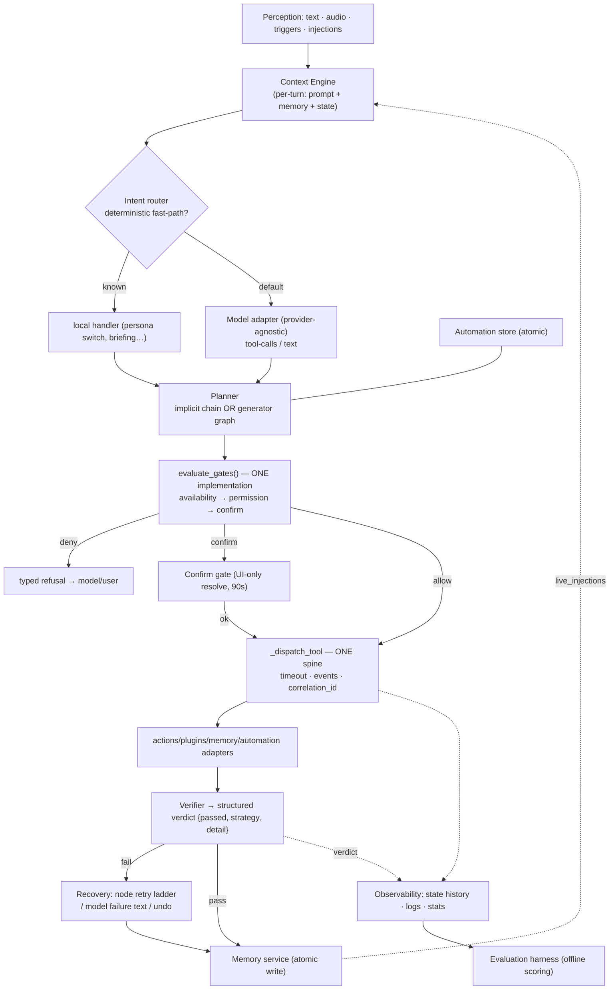
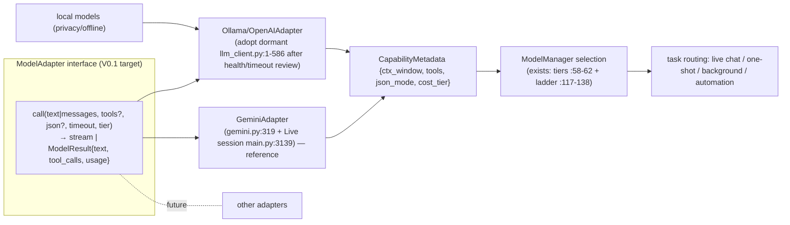

# BRAIN V0.1 — Target Architecture (spec §9 + §6 integration + §7 model independence)

All **PROPOSED** design unless a citation shows it already exists (VERIFIED). Nothing here is implemented by this document.

## 1. Design principles

1. **One authority per question.** Tool Registry = *what can run*; Permission/Confirm gates = *may it run now*; Automation runtime = *in what order, with what retry*; Verifier = *did it work*; Memory = *what do we know*. No second implementation of any question (fixes the adapter-mirror drift class of bug).
2. **Structured verdicts, not prose.** Every gate and check returns a typed result; failure strings exist only at the model-facing edge.
3. **Reuse before create.** The dormant cluster is either fixed-then-wired with tests or deleted — never left half-alive (`BRAIN_AUDIT` dormant register).
4. **Honesty.** Docstrings/prompts must not promise capabilities the code lacks (fixes the five documented prompt-vs-code discrepancies).
5. **Measured promotion.** Nothing new becomes load-bearing without a metric from `EVALUATION_PLAN.md`.

## 2. Component responsibilities (target)

| Layer | Component | Responsibility | Built from |
|---|---|---|---|
| Perception | Voice/Vision/Events | audio in, screenshots, file-watch, schedule, user text | **reuse** existing (`stt.py`, `visual/`, `triggers.py`, `event_bus.py`) |
| Cognition | Context Engine | assemble per-turn context incl. live memory updates | **extend** `_build_config` (`main.py:1379`) + `live_injections` |
| | Intent routing | deterministic fast-paths + model default; emits `IntentResult` | **consolidate** existing keyword hooks; promote per EVAL M2 |
| | Planning | implicit (model chain) or explicit (generator graphs only) | **consolidate**; retire/fix `planner.py` per gap-D decision |
| | Decision/Gates | single `evaluate_gates()` shared by all execution paths | **consolidate** `_execute_tool` + `adapters.py` |
| | Verification | structured verdict per executed tool/node | **extend** `_run_verification` |
| | Recovery | automation retries, connection/model ladders, undo | **reuse** |
| Memory | Memory service | atomic persistence, lexical recall, prompt formatting | **extend** `memory_manager.py` |
| Capability | Tool Registry + Catalog | merged Action/Plugin/inline metadata; risk vocabulary translation | **reuse** + fix `capability.py:84-88` |
| Execution | Dispatcher | one no-re-gate spine with timeouts + events | **reuse** `_dispatch_tool` |
| Automation | Engine/Store/Runtime | schedule, approve, retry, idempotency, stats | **reuse** (boundary below) |
| Interface | Model adapters | provider funnel with capability metadata | **extend** `gemini.py` + adopt `llm_client.py` |
| Observability | Logging + Event bus + stats | structured logs, state history, metric sinks | **extend** (currently missing) |

## 3. Target control flow (mermaid)



## 4. Interfaces & data contracts (PROPOSED)

```python
# core/gates.py (new home of the existing gate block, main.py:1560-1612)
GateResult = {"decision": "allow"|"deny"|"confirm", "rule": str, "requirement": str}
# called by: _execute_tool (main.py:1547) AND adapters.py:128 — mirror copy deleted

# verification envelope (extends main.py:597-613)
Verdict = {"passed": bool, "strategy": str, "detail": str, "tool": str}
# consumers: dispatch result, automation adapters.py:26 (replaces string sniff),
#            app_state VERIFYING (gets an emitter)

# Tool Registry record (already implicit in TOOL dicts, main.py:345-517)
ToolMeta = {name, source: action|plugin|inline, availability, risk_vocab,
            params_schema, requires_confirmation, requires_user_turn, timeouts}

# Memory op (formalizes memory_manager.py)
MemoryOp = {op: remember|forget|search, key, value?, query?, score?}

# Model adapter call (what llm_client.py already speaks + gemini.py:319)
ModelCall = {messages|text, tools?, json?, timeout, tier} → stream|ModelResult
```

Versioning: **V0.1 keeps dict-shaped records** (matches existing code; adding dataclasses to `automation/schema.py` style only where a new module is genuinely created). Registry gains a dict index alongside the existing `_all_records` list (`action_loader.py:180`) — the capability fix needs it anyway.

## 5. Failure handling model (typed, layered)

| Layer | Failure | Handling (VERIFIED today / PROPOSED delta) |
|---|---|---|
| Gate | forbidden / no-permission / no-confirm | typed deny with rule name (exists, `main.py:1560-1612`) |
| Dispatch | timeout, exception, policy fail-closed | captured, sent back to model as failure text (exists `:1845`) |
| Verification | strategy NotImplemented | **honest** skip (exists `verifier.py:350,359`) — never fake pass |
| Automation node | retryable | bounded retry+jitter (exists `runtime.py:410-438`); dangerous never retried |
| Automation run | cancel/pause/approval | state machine (exists `runtime.py:165-194`, `engine.py:164`) |
| Connection | WS/auth failure | exponential backoff (exists `main.py:3277-3289`) |
| Provider | quota | ladder demotion + cooldown (exists `model_manager.py:117-201`) |
| Persistence | crash mid-write | atomic temp+replace everywhere (**PROPOSED**; only `store.py:57` does it now) |
| NEW | gate mirror drift | impossible by construction — one `evaluate_gates()` |

## 6. Automation integration boundary (target state)

**Kept (VERIFIED today):** catalog refresh from live registries; shared dispatcher; same ledger object; real confirm gate; memory adapters; ticker; event allowlist + `correlation_id`.

**Changes (PROPOSED, ordered by leak severity):**
1. **Verifier leak:** `looks_like_failure` (`adapters.py:26-33`) reads the structured `Verdict` instead of 4 strings; `runtime.py:8-9` docstring becomes true.
2. **Gate drift:** `adapters.py:128-171` calls shared `evaluate_gates()`; `shutdown_jarvis` fail-closed applies on both paths; plugin confirmation stamp (`risk.py:108-109`) enforced where analysis happens.
3. **Catalog bug:** `capability.py:84-88` iterates `_all_records` (list); `validate.py:166` required-param check becomes live; acceptance test = a deliberately malformed generated workflow is rejected with the missing parameter named.
4. **Concurrency:** manual `start_run` marks `wf.status = RUNNING` and respects `active_run_for` (mirrors `engine.py:222`); dead sniffer `schema.py:189-206` deleted.
5. **Deletion of duplication** is the DoD: grep shows exactly one gate implementation, one failure matcher, one catalog reader.

**Tool Registry stays authoritative for capability** (Action+Plugin+inline merged at `main.py:1427-1429`); automation may add *workflow-level* limits (its own schema caps) but never invents tools.

## 7. Model independence roadmap (three-way distinction)

**Not the same thing:** (a) *model independence* = code works across providers; (b) *model selection* = tiers/ladder pick a model per task (exists); (c) *training/fine-tuning* = **out of scope for V0.1** (PROPOSED: V0.3+ research track, requires data pipeline first).

Target: one adapter interface, N providers, capability metadata per provider, task-based selection, local-model option.



**Phase-by-phase (evidence-driven):**
- **V0.1-a:** formalize interface = extract the shape `llm_client.py` already implements; add provider metadata fields to `ModelManager` tiers.
- **V0.1-b:** health-check + timeout/cancellation parity for the Ollama adapter; config keys for base URL; wire **behind** `ModelManager` (ladder gains "provider down" as a demotion reason — today it only handles quota, `model_manager.py:169-201`).
- **V0.1-c:** task-based selection uses existing tiers: background/automation → cheapest capable tier; live chat → primary. `RungStats` (collected, never read) becomes the feedback input — but only *after* EVAL harness exists (gap K).
- **Local models:** privacy + offline path via Ollama adapter; V0.1 supports it as an *opt-in* config, not default (INFERRED cost: latency on CPU-only box unmeasured — measure before promoting).
- **Failover:** provider failure → ladder step-down → typed "model unavailable" to user (never silent tool execution). Cancellation: automation already cancels nodes; adapter calls must honor the same token (PROPOSED).

## 8. What V0.1 explicitly does NOT change

- The confirm-gate security model (test-enforced, `test_tool_metadata.py:263-279`).
- The no-dispatcher-retry decision (`core/prompt.txt:131`).
- Gemini as the default conversation provider (adds adapters, doesn't remove).
- Prompt-driven tool choice as the default routing (router gains fast-paths only where measured).
- Python core (native rewrite = V0.2+, PROPOSED only).
